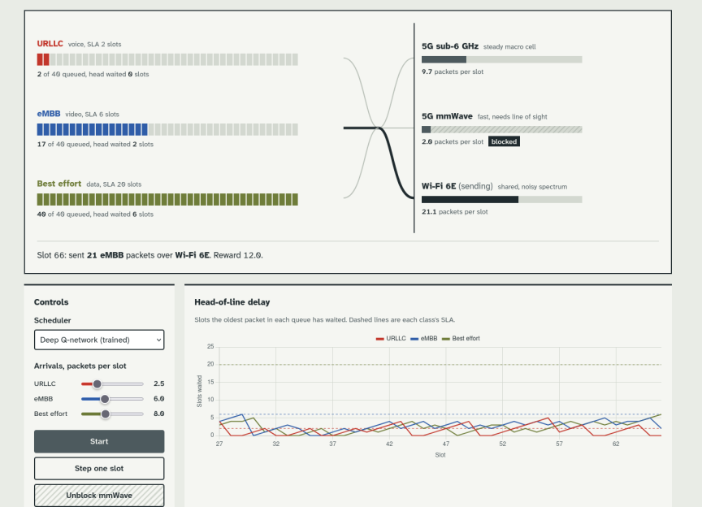
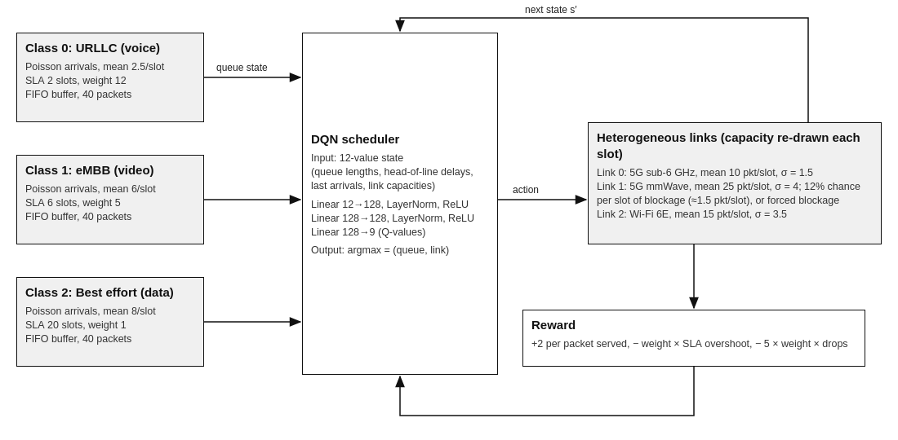
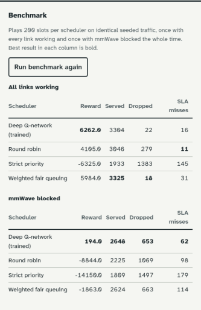

# DRL Packet Scheduler for Heterogeneous Networks

A Deep Q-Network (DQN) that decides, every time slot, which traffic queue to serve and which radio link to send it on: 5G sub-6 GHz, 5G mmWave or Wi-Fi 6E. We built it as a team for our Computer Networks course project at VIT Vellore. It includes a Gymnasium simulator, three classical baseline schedulers and a live browser dashboard.

The full write-up is in [docs/DRL_Packet_Scheduler_Report.pdf](docs/DRL_Packet_Scheduler_Report.pdf).



## Why we built this

A phone today is often connected to a 5G macro cell, a mmWave small cell and a Wi-Fi access point at the same time, and it carries traffic with very different needs. Voice has to leave within a few milliseconds, video needs steady throughput, and bulk downloads can wait.

Strict Priority, Round Robin and Weighted Fair Queuing [4] pick the next queue with fixed rules, and in their classic form they ignore the links underneath. The links keep changing. mmWave has the highest rate but loses most of its capacity when a hand or a wall blocks line of sight [5], and Wi-Fi capacity moves with contention. Strict Priority can starve best-effort traffic completely when high-priority load is steady.

We wanted a scheduler that learns a joint queue-and-link policy from experience: keep each class under its latency target, avoid buffer overflow, and keep working when mmWave goes down. We framed it as a Markov decision process and solved it with a DQN [1], following earlier work on deep RL for scheduling [2] and networking [3].

## Architecture



*Figure 1. Every slot, the DQN reads the queue and link state and picks one (queue, link) pair. The environment serves packets, returns a reward and the next state.*

### Traffic classes

Packets arrive as a Poisson process into a 40-packet FIFO buffer per class. Arrivals at a full buffer are dropped. Values are from [backend/envs/hetnet_env.py](backend/envs/hetnet_env.py).

| Class | Mean arrivals / slot | SLA target (slots) | Penalty weight |
|---|---|---|---|
| 0: URLLC (voice) | 2.5 | 2 | 12 |
| 1: eMBB (video) | 6.0 | 6 | 5 |
| 2: Best effort (data) | 8.0 | 20 | 1 |

The SLA target is the maximum head-of-line (HOL) delay before a class counts as late.

### Links

Each link's capacity in packets per slot is redrawn at random every slot:

- **5G sub-6 GHz:** mean 10, σ = 1.5. The steady fallback.
- **5G mmWave:** mean 25, σ = 4, with a 12% chance per slot of blockage that drops it to about 1.5. The dashboard can also force a continuous blockage.
- **Wi-Fi 6E:** mean 15, σ = 3.5, to model contention.

Only one queue is served per slot, over one link.

### State, action and reward

- **State (12 values):** queue length, HOL delay and last-slot arrivals for each class, plus the three link capacities from the previous slot.
- **Action (9 choices):** one (queue, link) pair, encoded as `queue * 3 + link`.
- **Reward:** +2 per packet served, minus `weight × (HOL delay − SLA)` for each class over its target, minus `5 × weight` per dropped packet. A late or dropped URLLC packet costs 12 times as much as a best-effort one.

The state holds last slot's link capacities, not the ones the scheduler is about to get. A real scheduler works from channel reports that are already slightly stale, and we wanted the simulator to have the same limitation.

### DQN

12 inputs → Linear 128 + LayerNorm + ReLU → Linear 128 + LayerNorm + ReLU → 9 Q-values. Training follows Mnih et al. [1] with a 20,000-transition replay buffer and a target network synced every 10 episodes. See [backend/models/dqn.py](backend/models/dqn.py).

## Training

[backend/train.py](backend/train.py) runs 300 episodes of 200 slots by default. ε starts at 1.0 and decays by 0.993 per episode to a floor of 0.05. Each slot samples a batch of 64 and updates with Adam (lr 0.001), γ = 0.99, MSE TD loss and gradient clipping at norm 1.0. Episodes that hit the time limit count as truncated, so the agent still bootstraps from the final state.

Our first model, trained only on the random 12% blockage, fell apart when mmWave stayed down: random blockages rarely last more than a slot or two, so the agent never saw a link that stayed dead. We fixed this by forcing a blockage in 40% of training episodes. Half of those are blocked for the whole episode and half for a window of 30 to 119 slots starting at a random point, so the agent also sees the link fail and come back.

## Results

We ran [backend/evaluate.py](backend/evaluate.py) with 10 seeds of 300 slots each (3,000 slots per scheduler). Every scheduler sees identical traffic and channel conditions for a given seed. An SLA violation is counted once per slot per class whose HOL delay is over target.

| Scheduler | Total reward | Served | Dropped | SLA violations |
|---|---:|---:|---:|---:|
| **Normal conditions** | | | | |
| DQN (trained) | **83,701** | **48,243** | **1,127** | 346 |
| Weighted Fair Queuing | 77,556 | 48,091 | 1,297 | 544 |
| Round Robin | 48,791 | 44,900 | 4,442 | **289** |
| Strict Priority | −153,526 | 27,630 | 21,605 | 2,350 |
| **mmWave blocked** | | | | |
| DQN (trained) | **21,028** | **41,396** | **7,763** | **920** |
| Weighted Fair Queuing | −6,470 | 41,334 | 7,784 | 1,607 |
| Round Robin | −85,745 | 35,273 | 13,845 | 1,028 |
| Strict Priority | −315,069 | 26,460 | 22,773 | 2,754 |

**Normal conditions.** The DQN's reward is 7.9% above WFQ's, with 13% fewer drops and 36% fewer SLA violations. Round Robin has fewer SLA violations (289 vs 346) but drops four times as many packets, because it gives the heavy best-effort queue the same share of slots as the light URLLC queue. Strict Priority serves the best-effort queue in only 3.1% of slots, its mean best-effort HOL delay is 51.5 slots against a target of 20, and it drops 21,605 packets.

**mmWave blocked.** With mmWave down, the best remaining link (Wi-Fi 6E, mean 15) is below the offered load of 16.5 packets per slot, so every scheduler drops packets. The DQN and WFQ serve and drop about the same amount, but the DQN has 43% fewer SLA violations and is the only scheduler with a positive reward. When we logged the actions, the baselines were chasing the last observed capacity: Wi-Fi is noisy, so they switch to the slower sub-6 GHz link in 10% of slots. The DQN stays on Wi-Fi in 98.6% of slots. Since capacity is redrawn every slot, last slot's value says little about the next one, and sticking with the link that has the higher mean wins.

**Effect of blockage training.** The repo also contains `drl_hetnet_model_v1_no_blockage.pth`, the earlier checkpoint trained without forced blockages. On the same 10-seed test it scores slightly higher under normal conditions (86,575), but with mmWave blocked its reward drops to −5,031,430 and it serves only 3,751 packets, because it still picks the dead mmWave link in 97.7% of slots.

## Dashboard

The Flask server runs the simulator slot by slot and shows the three buffers, the link capacities, the (queue, link) choice for each slot, and a live HOL-delay chart with each class's SLA as a dashed line. You can change the scheduler, the arrival rates and the mmWave blockage while it runs.

The Benchmark panel plays every scheduler on the same seeded traffic, once with all links up and once with mmWave blocked. It runs 2,000 slots per scheduler and draws new traffic on every click (pass `?seed=N` to `/api/benchmark` to repeat a run).

<p align="center"></p>

*Figure 2. The benchmark panel from the report, captured from an earlier build that ran 200 slots per scheduler.*

## Project structure

```
backend/
  app.py              Flask server and REST API
  train.py            DQN training loop
  evaluate.py         Multi-seed benchmark against the baselines
  envs/hetnet_env.py  Gymnasium environment (queues, links, reward)
  models/dqn.py       Q-network, replay buffer, agent
  models/baselines.py Strict Priority, Round Robin, WFQ
  checkpoints/        Trained models (.pth)
frontend/
  index.html, css/, js/  Dashboard (vanilla JS, canvas chart)
docs/
  DRL_Packet_Scheduler_Report.pdf
  images/
```

## Running it

Python 3.9+ is needed.

```bash
cd backend
python -m venv .venv
source .venv/bin/activate        # Windows: .venv\Scripts\activate
pip install -r requirements.txt
```

Start the dashboard, then open http://localhost:5000:

```bash
python app.py
```

Reproduce the results table:

```bash
python evaluate.py --seeds 10
python evaluate.py --seeds 10 --checkpoint checkpoints/drl_hetnet_model_v1_no_blockage.pth
```

Retrain from scratch (overwrites `checkpoints/drl_hetnet_model.pth` unless you pass `--out`):

```bash
python train.py --episodes 300 --seed 0
```

The server listens on 127.0.0.1 by default. Set `HOST=0.0.0.0` to expose it on your network and `FLASK_DEBUG=1` to turn on the debugger.

### API

| Method | Endpoint | Body / query | Does |
|---|---|---|---|
| POST | `/api/step` | `{"policy": "DRL Policy", "arrival_rates": [2.5, 6, 8]}` | Runs one slot |
| POST | `/api/reset` | none | Starts a new episode and clears blockage |
| POST | `/api/toggle-blockage` | `{"blocked": true}` | Forces mmWave blockage on or off |
| GET | `/api/benchmark` | `?seed=N` (optional) | Runs all four schedulers in both scenarios |

`policy` is one of `DRL Policy`, `Strict Priority`, `Round Robin`, `Weighted Fair Queuing`.

## Limitations

- Everything runs in simulation, and the link models are simple random processes. Training on measured 5G and Wi-Fi traces and testing in ns-3 are the next steps we'd take.
- One queue is served per slot, over one link.
- The results come from a single trained model. Retraining with several seeds would show how much they vary between runs.

## Team

| Name | Register number |
|---|---|
| Shreyas Ajit Parulekar | 25BCE2877 |
| Mohd Arham | 25BCE2530 |
| Aiden Trindade | 25BCE2876 |

Computer Networks (Slot B1+TB1), B.Tech CSE, SCOPE, VIT Vellore, 2026. Guide: Prof. Rajasekar VR.

## References

1. V. Mnih, K. Kavukcuoglu, D. Silver et al., "Human-level control through deep reinforcement learning," *Nature*, vol. 518, no. 7540, pp. 529–533, 2015. [doi:10.1038/nature14236](https://doi.org/10.1038/nature14236)
2. H. Mao, M. Alizadeh, I. Menache and S. Kandula, "Resource Management with Deep Reinforcement Learning," in *Proc. 15th ACM Workshop on Hot Topics in Networks (HotNets)*, 2016, pp. 50–56. [doi:10.1145/3005745.3005750](https://doi.org/10.1145/3005745.3005750)
3. N. C. Luong, D. T. Hoang, S. Gong, D. Niyato, P. Wang, Y.-C. Liang and D. I. Kim, "Applications of Deep Reinforcement Learning in Communications and Networking: A Survey," *IEEE Communications Surveys & Tutorials*, vol. 21, no. 4, pp. 3133–3174, 2019. [doi:10.1109/COMST.2019.2916583](https://doi.org/10.1109/COMST.2019.2916583)
4. A. Demers, S. Keshav and S. Shenker, "Analysis and Simulation of a Fair Queueing Algorithm," *ACM SIGCOMM Computer Communication Review*, vol. 19, no. 4, pp. 1–12, 1989. [doi:10.1145/75247.75248](https://doi.org/10.1145/75247.75248)
5. S. Rangan, T. S. Rappaport and E. Erkip, "Millimeter-Wave Cellular Wireless Networks: Potentials and Challenges," *Proceedings of the IEEE*, vol. 102, no. 3, pp. 366–385, 2014. [doi:10.1109/JPROC.2014.2299397](https://doi.org/10.1109/JPROC.2014.2299397)
